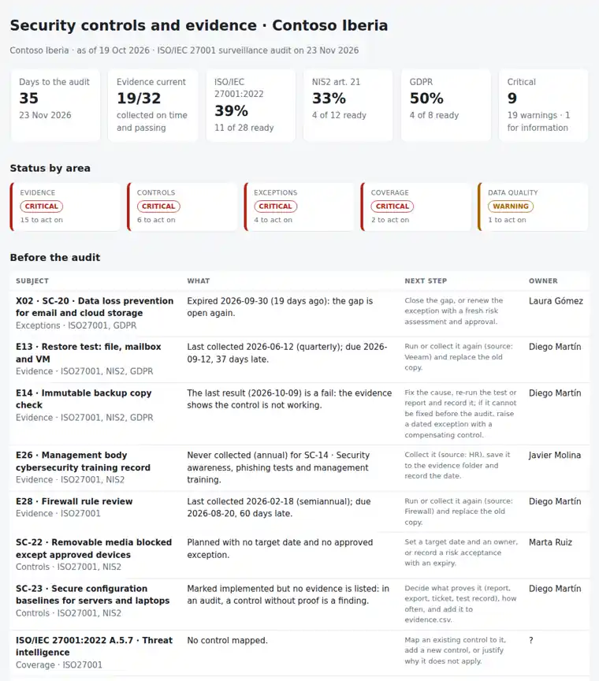

# Security Controls Evidence

One control register mapped to **ISO/IEC 27001:2022, NIS2 and GDPR**, and the evidence that proves each control works: which evidence is missing, late or failing, which controls are claimed without proof, which exceptions have expired, and how ready each framework is for the audit date. A few CSV files, one Python command, and the answer to: **what will the auditor ask for that we cannot show yet, and what do we collect before then?**

Python 3.10+, standard library only. Runs with fictional demo data out of the box.



## Why

Most audit findings are not about missing security. They are about missing proof:

- the **restore test** was done in June, the quarterly one in September was not, and the audit is in five weeks,
- the **immutable backup copy** has been failing for a week and nobody linked that to the controls,
- a control is marked **implemented** in the spreadsheet with **no evidence** behind it,
- the **exception** for DLP expired last month, so the gap is open again,
- the **management body training** that NIS2 asks for was never recorded,
- the same restore test answers ISO 27001, NIS2 and GDPR, but it is collected three times by three people, or not at all.

This tool keeps one register for the three frameworks and turns it into a work list in date order, an index for the auditor and a calendar of what to collect next.

## What it checks

| Area | Checks |
|---|---|
| Evidence | Never collected (critical). Late against its frequency: warning, critical when more than 30 days late or the audit is under 30 days away. Quarterly and longer evidence that falls due before the audit date. Last result `fail` (critical) or `partial`. No location recorded. |
| Controls | Implemented but no evidence listed (critical). Partial or planned with no target date and no approved exception (critical), past its target date, or still in progress. No owner. Not applicable without a justification. Review older than 12 months. |
| Exceptions | Expired (critical), expiring within 30 days or before the audit, not approved, no expiry date, no compensating control. |
| Coverage | Per requirement: **covered** (every mapped control implemented with current, passing evidence), **excluded** (justified not applicable), **at risk** or **gap**. A gap in a mandatory requirement is critical. |
| Data quality | Evidence for a control that does not exist, controls mapped to references that are not in the catalogue, unmapped controls. |

Outputs:

- `report.html`: single file, light and dark mode. It has:
  - days to the audit and readiness per framework;
  - the requirement table with what stands in the way of each requirement;
  - a nine-week collection plan with the audit week;
  - exceptions, the evidence register and the evidence that serves several frameworks.
- `review.md`: Before the audit / This month / evidence to collect, ready for the security review.
- `actions.csv`: one row per action, worst and soonest first, with owner, due date, frameworks and a `done` column.
- `audit-pack.csv`: the index to hand the auditor. Each row runs requirement → control → evidence → source, last collected, next due, result and location.
- `soa.csv`: the controls in Statement-of-Applicability form: applicable or not, justification, status, mapping and evidence count.
- `findings.csv`.
- `evidence-calendar.ics`: every due date in the next 12 months with a reminder a week before, plus the audit day.

How to prepare an audit with it, month by month: [docs/audit-prep-runbook.md](docs/audit-prep-runbook.md). File format and coverage rules: [docs/data-format.md](docs/data-format.md).

## Try it

```bash
git clone https://github.com/inigogonzalezgarcia/25-security-controls-evidence.git
cd 25-security-controls-evidence
python -m evidencepack demo
```

Open `output/report.html`, `output/review.md` and `output/audit-pack.csv`, and import `output/evidence-calendar.ics` into a calendar.

### The demo data

The demo is a made-up company: Contoso Iberia (`contoso.example`), reviewed on 19 October 2026 with an ISO/IEC 27001 surveillance audit on 23 November. It is also in scope for NIS2 and the GDPR. It has 23 controls, 33 evidence items and 3 exceptions, against a catalogue of 48 requirements. People, dates and results are invented.

The gaps are placed on purpose:

- **Overdue evidence:** a restore test 37 days late and a firewall rule review 60 days late.
- **Failing or partial evidence:**
  - an immutable backup copy check that failed;
  - partial MFA registration, vulnerability scan and phishing results.
- **Never collected:** the management body training record.
- **Controls:**
  - a removable-media control planned with no date;
  - configuration baselines claimed without evidence;
  - a control without an owner, a supplier control not reviewed for 16 months, and a "not applicable" without a justification.
- **Exceptions:** one expired DLP exception, one patching exception expiring before the audit, and one exception never approved.
- **Coverage:** an Annex A control nobody mapped.
- **Data quality:** evidence pointing at a control that does not exist.

## Use it with your own register

1. Export your control register to `data/controls.csv` and your evidence index to `data/evidence.csv` with the columns in [docs/data-format.md](docs/data-format.md).
2. Copy `sample_data/frameworks.csv` as a starting catalogue and add the requirements you are audited against: the rest of Annex A, ENS, ISO 22301…
3. Optionally add `data/exceptions.csv` and `data/settings.json` with the audit date.
4. Build the outputs:
   ```bash
   python -m evidencepack report data/ --out output --title "ISMS evidence · October"
   ```
   Options:
   - `--as-of 2026-10-31` re-runs a past or future review;
   - `--audit 2026-11-23` sets the audit date;
   - `--overdue-critical 30`, `--audit-window 30` and `--exception-warning 30` change the thresholds.

The register says where your weaknesses are. Keep it inside your organisation:

- real files at the top level (`controls*.csv`, `evidence*.csv`, `exceptions*.csv`, `frameworks*.csv`, `data/`) and the `output/` folder are excluded from Git by `.gitignore`;
- only the fictional files in `sample_data/` are committed;
- the tool reads an index of the evidence, never the evidence files themselves.

## Tests

```bash
python -m unittest discover tests      # or: pip install -r requirements-dev.txt && python -m pytest
```

There are 14 tests:

- **Parsing:** framework references and aliases; a semicolon CSV with a BOM and Spanish values.
- **Clean register:** a clean register with no findings and full coverage.
- **Evidence:**
  - missing evidence;
  - overdue thresholds at 17, 30 and 31 days late;
  - overdue turning critical when the audit is close;
  - "due before audit" only for quarterly or longer evidence, and its effect on coverage;
  - a "due soon" notice without an audit date, and the collection order;
  - fail and partial results, a missing location, one-off evidence that never expires, and evidence pointing at an unknown control.
- **Controls:**
  - planned with no plan, past its target and still in progress;
  - an approved exception that covers a planned control;
  - no evidence, no owner, an old review, "not applicable" with and without a justification, and an unmapped control.
- **Exceptions:**
  - expired, expiring on both sides of the 30-day threshold, and expiring before the audit;
  - not approved, no expiry, and no compensating control.
- **Coverage:**
  - a gap, excluded requirements, and every mapped control needing to be good;
  - optional requirements as warnings;
  - unknown references, and evidence reused across frameworks.
- **Demo end to end:**
  - every check fires and all seven outputs are written;
  - the calendar lines are folded to 75 bytes, and the audit day is in the calendar.

**Next steps for your register:**

- start with the controls you already report on every month: the evidence is usually there, it only needs a date and a place;
- map each control to ISO 27001, NIS2 and GDPR once, so one piece of evidence serves all three;
- add the audit date as soon as it is booked, and book the quarterly and annual tests from the calendar.

## Background

Built from my work applying ISO 27001, NIS2 and GDPR in IT operations, including:

- preparing evidence and answering audits;
- access reviews, privileged access with PIM, and Conditional Access;
- device encryption, backup and disaster recovery tests;
- risk registers and treatment plans, and security policies, metrics and KPIs.

Written from scratch with fictional data; no employer documents, controls or audit results are used. Requirement titles are short descriptions, not the text of the standards.

## Customisation and contact

Want this adapted to your organisation? For example:

- your own control catalogue or ENS;
- importing evidence dates straight from Intune, Entra ID or your backup tool;
- reminders in Teams;
- a dashboard for the management body.

Get in touch:

- Website (contact form): [inigogonzalezgarcia.github.io](https://inigogonzalezgarcia.github.io/about.html#contacto)
- LinkedIn: [linkedin.com/in/igonzalez93](https://www.linkedin.com/in/igonzalez93)

## License

MIT
